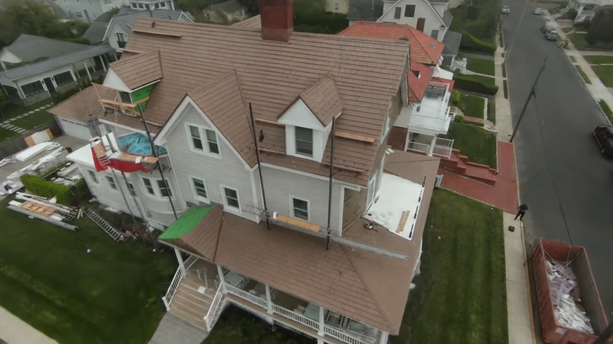

# House Gaussian Splat

A 3D Gaussian splat of a house, made from drone footage. Fly around it in your browser:

**https://dovifeldman.github.io/House-Gaussian-Splat/**

Drag to orbit, right-drag or two fingers to pan, scroll or pinch to zoom. It downloads a 50 MB scene, so give it a few seconds.

## How it was made

- **Footage:** 12 drone clips, 7 minutes in total, from far away to very close
- **Frames:** 400, picked by how much the camera moved, so slow far-away clips gave few and close passes gave many
- **Cameras:** COLMAP + GLOMAP via pycolmap
- **Training:** Brush, 30,000 steps, 2 h 27 min on an Apple M5 with 16 GB
- **Viewer:** three.js + GaussianSplats3D

Built with the pipeline in [GAUSSIAN_SPLATTING](https://github.com/DoviFeldman/GAUSSIAN_SPLATTING).

## Problems and fixes

| Problem | Fix |
|---|---|
| The solve placed 400/400 frames, but one low porch clip was in the wrong spot, with big jumps between neighbouring frames | Kept the good cameras fixed and re-registered the bad frames against them. It took minutes and needed no re-matching |
| Brush's default 1920 px limit would have downscaled the 2566 px undistorted frames | Trained with `--max-resolution 2566` |
| The fly-around was tilted because a sloped roof was picked as "up" | Took "up" from the average drone horizon and only allowed planes within 12° of it |
| The viewer opened with the camera inside the roof, because the library skips the start position for an external camera | Set the camera position before creating the viewer |
| Video rendering hung at 0% CPU with no error | `record_video.sh` needs an absolute path to the splat |

## Known limits

The drone never filmed past the neighbouring houses, so the edges get patchy and some angles show black behind the house. Moving cars can look ghosted.
